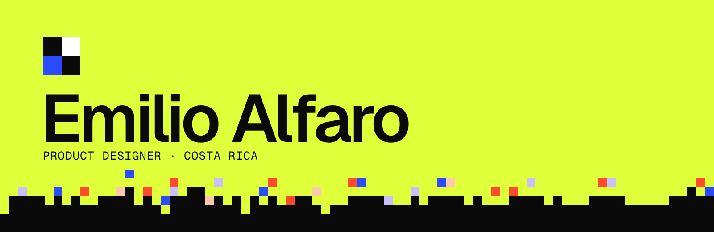

I design products for payments and fintech, and I show how. Studying IT Management at [TEC](https://www.tec.ac.cr/), Costa Rica.

Interested in tech for transparency, collaboration and sustainable change.

 

## Selected work

| Project | What it is | My role |
| :-- | :-- | :-- |
| **[Senda](https://withsenda.site/)** | Sending money home as easily as sending a message, from a WhatsApp chat. | Co-Founder & CPO. Landing: [Senda.App](https://github.com/SendaLabs/Senda.App) |
| **[TrustBid](https://trustbid.org/)** | Every fund leaves a trace: spending records NGOs can share with donors. | Product Designer / PM. [Code](https://github.com/TrustBid/platform) |
| **[ZEEK Hub](https://zeek-hub.vercel.app/)** | The app volunteers of the [ZEEK](https://zeek.es/) builder community use to see their tasks, calendar and events. | UI design and product direction. [Code](https://github.com/ZEEKCR/zeek-hub) |
| **[OFFERHUB](https://offer-hub.tech/)** | Open-source payments and escrow infrastructure for marketplaces. | Growth lead: brand and community. [Code](https://github.com/OFFER-HUB/OFFER-HUB) |

Each project is explained, with screens, at **[framedby.me](https://framedby.me)**.

 

## Tools

 

## Find me

